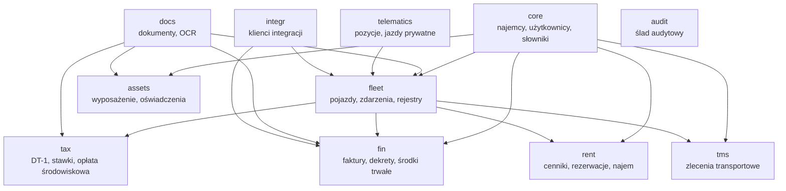
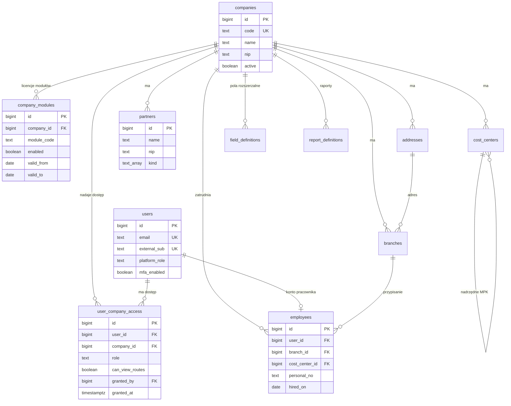
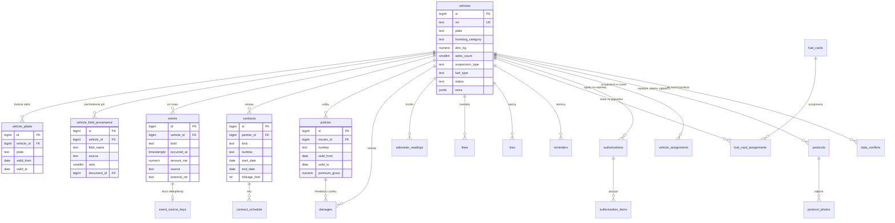
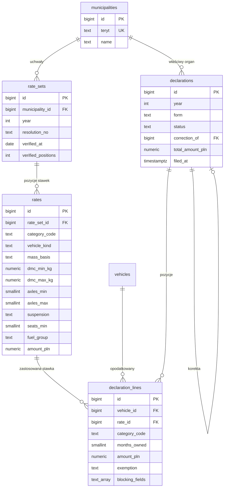
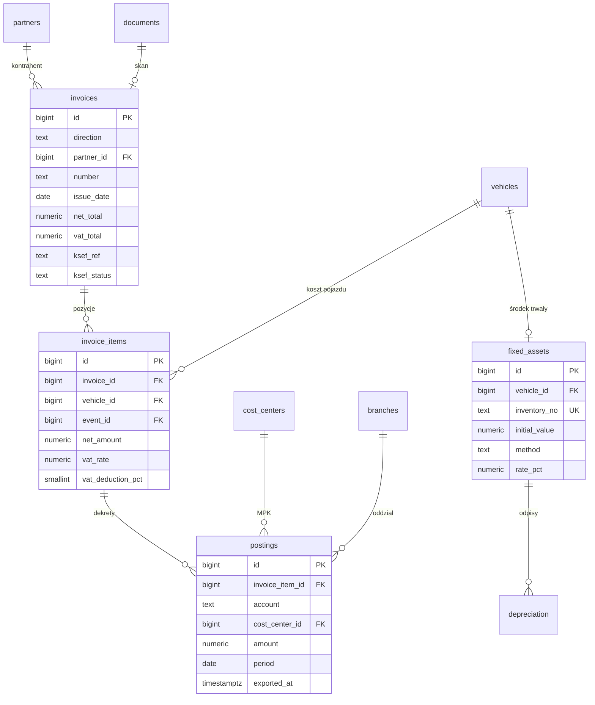
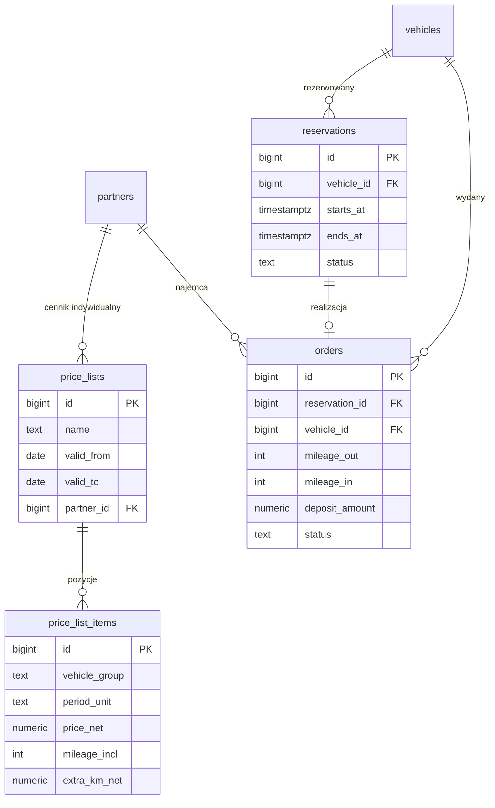
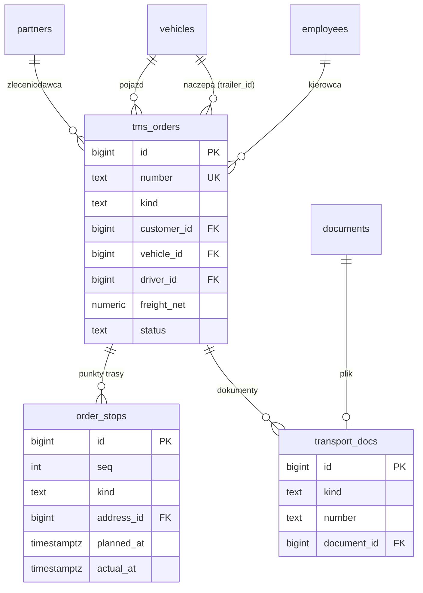
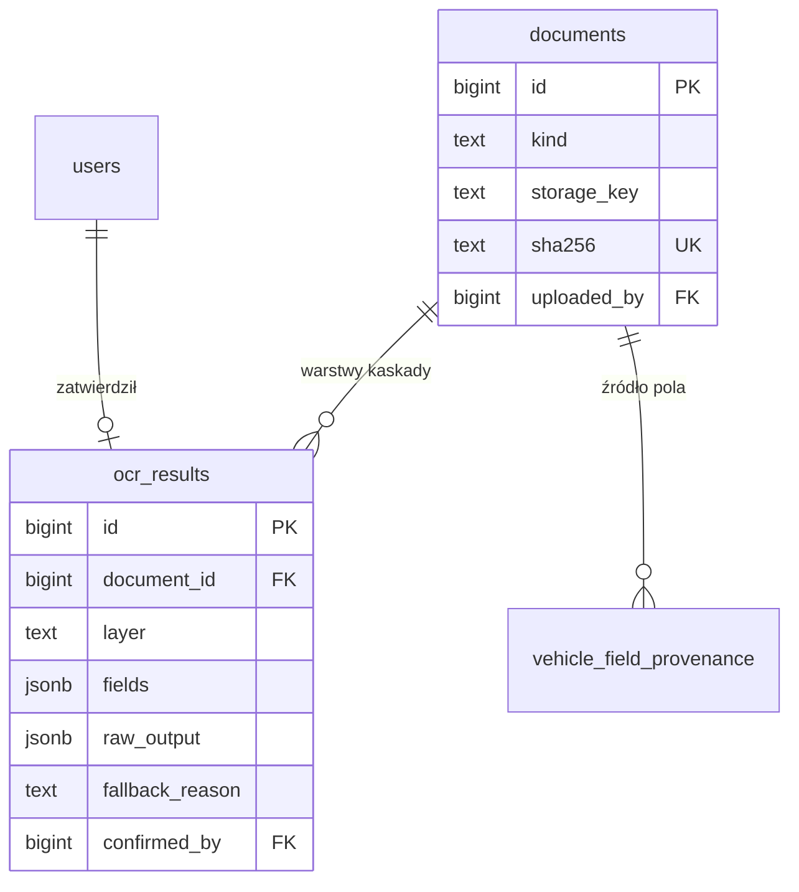
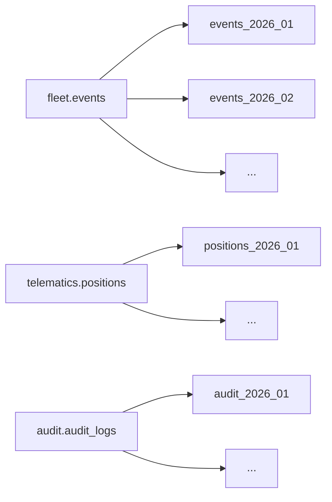

# Diagramy ERD PostgreSQL

Diagramy w składni Mermaid — renderują się w podglądzie Markdown w IDE i na GitHubie. Definicje kolumn: [projekt bazy danych](10-database-design.md).

Na diagramach pominięto kolumny audytowe (`created_at`, `created_by`, `updated_at`, `updated_by`) oraz `company_id`, które występuje **w każdej tabeli danych klienta** i jest częścią każdego klucza obcego między tabelami najemcy (`(company_id, x_id) → (company_id, id)`, patrz konwencja 9 w [projekcie bazy](10-database-design.md)).

## Mapa schematów

Strzałka oznacza kierunek zależności: `tax` czyta z `fleet`, nigdy odwrotnie. Zależność cykliczna między schematami jest zabroniona — wymuszane uprawnieniami ról bazodanowych, nie tylko przeglądem kodu.

## core — najemcy i ludzie

**`user_company_access` to sedno modelu uprawnień.** Dostęp do spółki jest wierszem, który widać i który da się odebrać — nie właściwością roli. Rola też jest per spółka: ta sama osoba może być księgową w jednej spółce i przeglądającym w drugiej. To odpowiedź na dług z poprzedniego systemu, gdzie rola administratora pomijała filtrowanie wszędzie i nie było jak tego ograniczyć.

## fleet — pojazd i jego oś czasu

Trzy rzeczy, które ten diagram ma unaocznić:

1. **`vin` jest unikalne, `plate` nie.** Numer rejestracyjny mieszka w `vehicle_plates` z zakresem dat i ograniczeniem wykluczającym nakładanie się okresów.
2. **`events` jest jedną tabelą dla wszystkich typów zdarzeń**, a nie osobną tabelą na tankowania, osobną na naprawy i osobną na mandaty. Rejestry obok (`policies`, `damages`, `contracts`) trzymają dane **strukturalne**, kwoty i daty trafiają do `events`.
3. **`vehicle_field_provenance` wisi obok `vehicles`**, a nie w środku. Kartoteka trzyma wartość obowiązującą, tabela obok — wszystkie warianty z rangami i wskazaniem dokumentu.

## tax — podatek od środków transportowych

`declaration_lines.rate_id` wskazuje **konkretną pozycję konkretnej uchwały**. Bez tego złożona deklaracja jest nieodtwarzalna: za trzy lata nikt nie ustali, czy kwota wynikała z uchwały, czy z pomyłki. `rate_sets.verified_positions` mówi, ile pozycji faktycznie porównano ze źródłem — dla Warszawy 2026 jest to 45 z 45.

## fin — od faktury do dekretu

Ścieżka `invoice_items → event_id` jest tym, co likwiduje podwójne wprowadzanie danych: pozycja faktury za paliwo wskazuje na **to samo zdarzenie**, które widzi kartoteka pojazdu i raport zużycia. Dziś ta sama informacja istnieje osobno w systemie flotowym i osobno w księgowym.

## rent — najem

## tms — zlecenia transportowe

Pojazd i naczepa wskazują na **tę samą tabelę** `fleet.vehicles` — naczepa jest pojazdem z rodzajem „przyczepa", a nie osobną encją. To istotne podatkowo: przyczepa i naczepa podlegają DT-1, gdy łącznie z pojazdem silnikowym mają DMC od 7 t, i mają własną tabelę stawek, inną niż samochód ciężarowy.

## docs i OCR

Jeden dokument ma **wiele** wierszy `ocr_results` — po jednym na warstwę kaskady. `fallback_reason` odpowiada na pytanie, dlaczego zadziałała warstwa niższa. Bez tego pola awaria warstwy wyższej objawia się jako gorsze dane, nie jako błąd; dokładnie ta klasa problemu kosztowała dwie diagnozy w poprzednim systemie.

`documents.sha256` jest unikalne w ramach najemcy — ten sam plik nie wchodzi dwa razy.

## Partycjonowanie

Trzy tabele rosnące bez ograniczeń są partycjonowane miesięcznie po dacie zdarzenia. Partycje tworzy zadanie cykliczne z wyprzedzeniem, a nie mechanizm reagujący na pierwszy nieudany zapis.

Retencja przez odłączanie partycji: pozycje GPS starsze niż 12 miesięcy są odłączane i archiwizowane po zbudowaniu agregatów dobowych. Odłączenie partycji jest natychmiastowe; kasowanie wierszy przy tej skali nie jest.

## DANE WSADOWE !! DO ZROBIENIA

## DANE KIEROWCÓW

